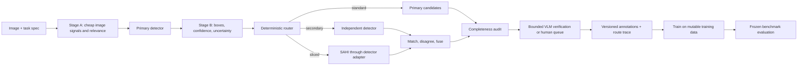

# Adaptive routing for custom object detection: project board

**Updated:** 2026-11-09 · **Owner:** user · **Implementer:** Claude (Codex was blocked; see [reviewer_suggestion.md](reviewer_suggestion.md))

This file merges the plan, the Phase 0 integration map and the implementation notes. The reviewer's log stays separate in [reviewer_suggestion.md](reviewer_suggestion.md).

- **Part A — Board:** what is done, what is left, what needs a decision. Update this part as work lands.
- **Part B — Spec:** the plan. It is the source of truth for requirements.
- **Part C — Integration map:** greenfield defaults, hardware, fixture, assumptions.
- **Part D — How it works and why:** decision flow, behavior changes, design notes.

**Snapshot:** phases 0–4 done, Phase 5 started, Phase 6 not started. Routing is disabled by default (`routing_enabled: false`). Tests: 92 default passed (re-run by the analysis agent via `pixi run test`); `-m clip` and `-m lmstudio` 1 passed each (rerun under pixi by main_agent, not by the analysis agent). R3-1…R3-5, R4-1, T-6 and P2 are fixed. **Git:** 22 commits on `master` (head 2267644); environments are managed with pixi only, tags `v0.1-phase4-baseline` (208713e) and `v0.2-r3-blockers-fixed` (0435d99); the backup branch `backup/pre-author-rewrite` holds the pre-rewrite history.

---

# Part A — Board

## Phase tracker

| Phase | Deliverable (from spec) | Status | Notes |
|---|---|---|---|
| 0. Map current pipeline | Integration points, formats, versions, hardware, baseline metrics, tiny fixture | **Done** (greenfield) | No existing repo, so neutral defaults behind adapters (Part C). Baseline metrics N/A: no detector yet. |
| 1. Typed contracts + trace | Pydantic models, JSON Schema, config validation, stable IDs, feature flag, persisted trace | **Done** | |
| 2. Stage A + primary Stage B | Independent relevance/quality/difficulty, zero-box handling, shadow decisions | **Done** | Shadow so far only on the fixture. Compression and domain-distance signals missing (B-1). |
| 3. Router + secondary + SAHI | Pure policy, matching, bounded slicing, coordinate tests, fusion | **Done** | SAHI path tested with fake crop-capable detectors only; needs T-1. |
| 4. VLM + completeness | Self-hosted VLM adapter, bounded verification, human queue, completeness states | **Done** | qwen3-vl-4b via LM Studio, verifier only. |
| 5. Calibration + evaluation | Human-checked split, threshold fitting, frozen benchmark, 3-way comparison | **Started** | Done so far: frozen lock, isolation, VLM-agreement scoring, CLIP scorer. Blocked on T-2. |
| 6. Rollout | Shadow, canary by source group, gated promotion, rollback config | **Not started** | |

## Needs your decision

| ID | Decision | Default now | Recommendation |
|---|---|---|---|
| D-1 | `policy.unknown_relevance_as`: route unknown relevance like `medium` or `high` | `medium` | Keep for shadow. Use `high` only if relevance is often missing in production (more cost, less miss risk). |
| D-2 | `policy.moderate_without_secondary`: `vlm_then_human` or `human` | `vlm_then_human` | Keep. |
| D-3 | `policy.cross_class_always_review` | `true` | Keep until a secondary detector exists. |
| D-4 | `vlm.absent_rejects`: let a VLM "absent" reject a box | `false` | Set a target for `absent_precision_wilson_lower95` in config *before* measuring, then decide (B-6). |
| D-5 | CLIP relevance bands on the `clip_prompt_softmax_v1` scale | none (`raw_scale: unspecified`) | Choose them from the calibration split (never the frozen set), or fit a calibrator (B-2, B-3). |
| D-6 | GPU budget counts only adapter-measured device time, no wall-time proxy | measured only | Confirm. |
| D-7 | VLM model: 4B in use, 8B not loaded | `qwen3-vl-4b-instruct` | Load 8B and compare on real crops (B-6). |
| D-8 | Commit the work (reviewer H3: per-phase commits) | **Resolved 2026-11-09** | Baseline committed in 6 commits; one commit per R3 fix. Older commits had their author email rewritten from the NCS address to the gmail one (user chose this). Delete `backup/pre-author-rewrite` and `refs/original/*` once you are sure. |

## To do — ready now

| ID | Card | Why it matters | Unblocks |
|---|---|---|---|
| T-1 | **Choose a real primary detector** and write a crop-capable `Detector` adapter that reports a weights `artifact_digest` and CUDA-event `gpu_ms` (use `embedder.cuda_timer`). Use an open-vocabulary detector if classes must work without training. | Shadow mode only replays precomputed boxes; SAHI is unavailable with `PrecomputedDetector`. | Real shadow runs, SAHI, B-5, Phase 6 |
| T-2 | **Build the human-checked sample** across class, domain, resolution, object size, crowding, positives/negatives and low similarity. Split it into calibration / development / frozen by source or near-duplicate group, then lock the frozen set (`evaluation.lock_frozen_set`). | Every Phase 5 card needs it. | B-2 … B-7 |
| T-3 | **Independent review** (a human or Codex) of `pipeline._candidates`, `_verify`, `_apply` and `policy.route`. | The same model family wrote and reviewed the code. | Trust in routing |
| T-4 | **Stage A gaps:** add a compression indicator, and a domain-distance indicator when a reference distribution exists (`StageA.domain_distance` exists but is never filled). | The spec's Stage A list is incomplete. | Domain-shift audit sampling (spec rule 7) |

## Backlog — blocked

| ID | Card | Blocked by |
|---|---|---|
| B-1a | Real-image shadow run from saved predictions (`PrecomputedDetector`) | saved predictions from a real detector, plus labels |
| B-1b | Live primary and real SAHI shadow | T-1 |
| B-2 | Relevance calibrator (P(any target), modelling class correlation) and difficulty calibrator (against a defined primary-detector failure event). The `RelevanceCalibrator` protocol has no implementation. | T-2 |
| B-3 | Threshold fitting under explicit constraints, with bootstrap/CI by source group; record calibrator versions and the data hash | T-2, B-2 |
| B-4 | Record numeric promotion targets in config (recall, FN rate, cost, precision) **before** the frozen run | user, T-2 |
| B-5 | Frozen benchmark: baseline primary-only vs always-expensive vs adaptive (mAP50–95, stratified recall, FP/image, review rate, latency, GPU s, VLM calls, route confusion, low-relevance FN audit) | T-1, T-2, B-3, B-4 |
| B-6 | VLM agreement on real human labels, 4B vs 8B (`evaluation.vlm_agreement`); decides D-4 | T-2, D-7 |
| B-7 | Training-pipeline integration: replace the substitute loader `export.load_annotations`; train identical detectors on baseline vs routed annotation sets | a trainer |
| B-8 | Optional secondary detector adapter (independent model; correlated errors expected if trained on the same data) | T-1 |
| B-9 | Phase 6: shadow, then canary by source group, versioned rollback config, gated promotion. Automatic discard stays off until gates pass. | B-5 |
| B-10 | Minor: `expected_budget.vlm_calls` reports the cap, not an estimate. With `absent_rejects: true`, a rejected primary box stops counting as unmatched in completeness. `legacy` mode stops on a missing prediction row instead of queuing it. | — |

## Done

| ID | Card | Phase | Evidence |
|---|---|---|---|
| F-1 | Integration map + reproducible fixture (non-COCO class IDs) | 0 | Part C; `tests/routing/helpers.make_fixture` |
| F-2 | Pydantic v2 contracts, committed JSON Schemas + drift test | 1 | `schemas.py`, `schemas/`, `test_committed_json_schemas_match_models` |
| F-3 | Validators: unknown class, NaN/inf, bad boxes, missing model version, coordinate system | 1 | `test_detection_rejects_invalid`, `RouteRecord._registry_and_bounds` |
| F-4 | `schema_version` + SHA-256 IDs on persisted records; `ScoreRecord` realised as `StageA`/`StageB` | 1 | `schemas.py` |
| F-5 | Feature flag off by default; legacy output byte-identical | 1 | `test_feature_flag_off_keeps_legacy_output` |
| F-6 | Stage A quality + relevance (raw vs calibrated kept apart, `unavailable` never low) | 2 | `scoring.stage_a` |
| F-7 | Stage B features; `difficulty_pre_secondary` preserved; zero boxes give `unknown` | 2 | `scoring.estimate_difficulty`, row 3 tests |
| F-8 | Pure deterministic policy; `hashlib` audit sampling; replay across `PYTHONHASHSEED` | 3 | `policy.py`, `test_routing_replays_identically_across_processes` |
| F-9 | Class-aware matching, directional disagreement, provenance-preserving fusion | 3 | `matching.py`, row 5 tests |
| F-10 | Native slicer: offset applied once, clipping, IoS union merge, per-tile budget | 3 | `slicing.py`, SAHI + r4 tests |
| F-11 | LM Studio VLM verifier: one attempt, strict schema, every failure gives `uncertain` | 4 | `adapters.LMStudioVLM`, row 7 tests, `-m lmstudio` |
| F-12 | Completeness audit; `complete` only by a human or a calibrated policy | 4 | `completeness.py` |
| F-13 | Resumable SQLite step cache; route persisted before expensive calls; error queue | 4 | `test_resume_after_crash_does_not_repeat_calls` |
| F-14 | Budget caps (slices, VLM, elapsed, GPU) before each escalation | 4 | `test_slice_budget_blocks_sahi`, `test_elapsed_and_gpu_caps_stop_escalation` |
| F-15 | Frozen-set hash lock + group isolation | 5 | `evaluation.py`, row 10 tests |
| F-16 | Codex review rounds 1–2 fixed (SAHI parents, Stage A cache, VLM binding, explicit prediction rows, file digests) | — | git history (commits before `f2dd581`) |
| F-17 | H1: Codex prompt path fixed | — | Part B, Codex prompt |
| F-18 | Poor-quality cut-offs moved to config (`quality:`) | 2 | Part D |
| F-19 | Open policy choices made config knobs, route-v1 defaults kept | 3 | Part D |
| F-20 | One writing job per output directory (OS lock; exit code 2) | 4 | Part D |
| F-21 | VLM "absent" sends to review by default (`vlm.absent_rejects`) — **behavior change** | 4 | Part D |
| F-22 | Moderate route without a second detector no longer auto-accepts primary boxes — **behavior change** | 4 | Part D |
| F-23 | `difficulty_uncalibrated` reason code; dead `sahi` extra removed; `clip` extra; GPU-time rule | — | Part D |
| F-24 | VLM-vs-human agreement scoring (one label set scores several VLMs) | 5 | Part D |
| F-25 | CLIP relevance scorer with scale guard and weights digest | 2/5 | Part D, `-m clip` |
| F-26 | R3-1: export and report use only the current run's records | 4 | f2dd581 |
| F-27 | R3-2: cross-class conflicts stay in review even on VLM `absent` | 4 | cd33250 |
| F-28 | R3-3: VLM calls are **at-most-once** on resume; an interrupted request becomes `uncertain`/review and is not re-sent — **behavior change** | 4 | f530f98 |
| F-29 | R3-4: a raw scorer missing a task class raises a low band to medium | 2 | 5cbbc48 |
| F-30 | R3-5: a bare human `complete` cannot clear open findings (open unmatched candidates, unresolved checks and escalation failures block it). Explicit per-finding human adjudication is still absent | 4 | 0435d99 |
| F-31 | R4-1: calibrator output that omits a task class, or has `any_p` < P(class) − 1e-6, adds warning `calibrator_output_incomplete_or_inconsistent` and a low band becomes medium (status stays `calibrated`). Non-finite or out-of-range values already go to the error queue via the schema. 2 new tests | 2 | 770c9d3 |
| F-32 | T-6 (user decided: unknown): with calibrated Stage A, a class with no calibrated probability is no longer judged by raw similarity vs `raw_high`. The completeness audit adds reason `calibrator_missing_class:<id>` and status `unresolved` (human review; no VLM verdict clears it). Uncalibrated runs unchanged. 2 new tests | 2/4 | 6a31afd |
| F-33 | P2: for each calibrated class with no probability, `policy.route` adds `human_review`, reason `calibrator_missing_class:<id>` and priority ≥ 1; the audit lists the class in `suspected_missing_classes`. Works without a VLM. 1 new test | 3/4 | 76455b3 |

Qualifications still open on earlier rows (earlier review): F-12 is now covered by F-30. F-13 resume guarantee is now at-most-once for the VLM (F-28). F-14 export mixing is fixed (F-26). **F-15 is utility-level only:** `vad-route shadow` does not accept a split or lock, so production runs do not enforce isolation. Replayed CLIP scores in JSONL carry no scale check (D-5).

## Acceptance tests (spec table, with status)

| Test | Required result | Status | Tests |
|---|---|---|---|
| Arbitrary class registry | A class absent from public datasets flows through prompts, adapters, route, VLM contract and annotation export without hard-coded mappings. | ✅ | `test_arbitrary_class_flows_end_to_end`, `test_class_mapping_for_secondary` |
| Independence | Low relevance/high difficulty and high relevance/low difficulty keep distinct scores and take the configured routes. | ✅ | `test_relevance_and_difficulty_are_independent` |
| Zero detections | High relevance plus zero boxes never becomes `easy` or an accepted negative; missing secondary/VLM capacity creates review. | ✅ | `test_high_relevance_zero_boxes_is_never_easy_or_negative` + 2 |
| Stable routing | Same image, artifact hashes, config and seed give identical actions, reasons and audit sampling across process restarts. | ✅ | `test_routing_replays_identically_across_processes` |
| Disagreement | Matched, unmatched, duplicate and cross-class boxes give correct directional disagreement and keep provenance. | ✅ | `test_directional_disagreement_and_provenance` |
| SAHI coordinates | Tile-edge and overlap detections map to original pixels once, deduplicate correctly and stay in bounds. | ✅ (fake detector) | `test_sahi_*` |
| VLM failures | Malformed, contradictory, timed-out or unavailable responses become `uncertain`; retry/call caps hold. | ✅ | `test_vlm_*`, `test_r3_*` |
| Completeness | A missing ground-truth-like proposal, a high-relevance class with no box, and an audited zero-box image create explicit unresolved/review states. | ✅ | `test_unmatched_proposal_creates_review_state` + 3 |
| Budget and recovery | Slice/time/GPU limits stop escalation; a repeated job resumes without duplicate calls or annotations. | ✅ | `test_resume_after_crash_*`, `test_r4_*` |
| Data isolation | Calibration and frozen-eval group IDs don't overlap training; changing thresholds never rewrites frozen annotations. | ✅ | `test_split_groups_must_not_overlap`, `test_frozen_set_is_locked_*` |
| End-to-end | On a tiny checked fixture, exported annotations load in the existing training pipeline and the route trace explains each decision. | ⚠️ substitute loader | `test_end_to_end_shadow_and_legacy` (B-7) |

## How to run

```bash
pixi install                                              # pixi only; add `-e clip` for the CLIP scorer
pixi run test                                             # 92 tests, no network / GPU
pixi run -e clip test-clip                                # live CLIP (local weights)
pixi run test-lmstudio                                    # live VLM (LM Studio)
pixi run vad-route shadow --config configs/routing/example.yaml --images manifest.jsonl \
  --primary-predictions preds.jsonl --primary-version mymodel@sha --out runs/shadow1
```

---

# Part B — Spec (the plan)

## Goal and integration boundary

Add an image-level routing layer to the existing self-hosted Python detector pipeline. It decides how much inference and review each image needs, then emits traceable candidate annotations for the current dataset writer and trainer. It must support arbitrary project-defined classes, including classes absent from public detection taxonomies. Python owns routing decisions; Claude Code or Codex can implement and inspect the code, but neither is a runtime decision maker.

**First repository task:** locate the current image manifest, class registry, primary detector call, prediction format, annotation writer, training entry point and evaluation split. Wrap those interfaces. Preserve current detector and annotation behavior behind a feature flag until the new path passes the acceptance tests. This plan does not assume a particular detector family, labeling format or VLM. *(Greenfield here: see Part C.)*

Each image has three distinct questions:

1. **Relevance:** How likely is at least one configured target class present? Estimate per class and aggregate to image level. Relevance is not image quality.
2. **Difficulty:** How likely is the primary detector to miss or mislocalize a target **if one is present**? Estimate from visual and prediction signals. Record `unknown` when evidence is insufficient.
3. **Annotation completeness:** After candidate fusion, is there evidence of a target instance with no accepted annotation? This is an audit result, not another synonym for difficulty.

Keep raw embedding similarity, calibrated probability, quality signals and difficulty score in separate fields. In particular, `zero primary detections` never implies `easy` or `irrelevant`.

## Processing graph



### Two-stage scoring

**Stage A, before detection:** validate the image; compute resolution, blur/exposure/compression indicators, a domain-distance indicator if a reference distribution exists, and per-class text–image similarity using class-specific positive prompts and confusing negative prompts. The stage outputs raw features plus calibrated relevance probabilities when a calibrator exists. It may flag a likely hard image but must not claim an object-size or occlusion measurement without an object proposal.

**Stage B, after primary detection:** calculate normalized box area, predicted crowding/overlap, confidence or margins when supported, class ambiguity, count, and the contradiction between high relevance and zero boxes. Use Stage A and these features to estimate difficulty. If a secondary detector is run, recompute with class-aware matching and disagreement. Store `difficulty_pre_secondary` and `difficulty_final`; never silently replace the former, because its value explains why the secondary path was selected.

For matched boxes, use an explicitly configured IoU threshold and class mapping. Disagreement includes unmatched candidates from either detector and localization differences among matched boxes; record direction and count, not just a Boolean. A secondary model trained on identical data may have correlated errors, so its disagreement is evidence for review, not ground truth. If no secondary model exists, mark disagreement `unavailable` and allow routing from other signals.

## Contracts and repository layout

Suggested package, adapted to the repository. As built:

```text
src/vad/routing/
  schemas.py       Pydantic v2 records + JSON Schema export
  task_config.py   class registry, prompts, thresholds, budgets, policy knobs, versions
  scoring.py       Stage A and Stage B feature extraction
  adapters.py      detector / relevance / VLM protocols; precomputed + LM Studio adapters
  embedder.py      optional open_clip relevance scorer + CUDA-event timer
  slicing.py       native SAHI-style tiling and original-coordinate conversion
  matching.py      class-aware matching, deduplication, provenance-preserving fusion
  policy.py        pure deterministic route function
  completeness.py  unmatched proposals and coverage audit
  pipeline.py      bounded orchestration, persistence, resumability, job lock
  evaluation.py    isolation, frozen lock, route/cost report, VLM agreement
  export.py        COCO-style versioned export + loader
  cli.py           vad-route
configs/routing/example.yaml
tests/routing/
```

Define Pydantic v2 models and export their JSON Schemas. Reject unknown class IDs, nonfinite scores, invalid boxes, missing model versions and unsupported coordinate systems. Store a `schema_version` and content/hash IDs on every persisted record. Use canonical `xyxy` **pixel coordinates in the original image**, with `0 <= x1 < x2 <= width` and the analogous y rule. Convert sliced boxes before matching; keep slice origin and model provenance. Keep model confidences as raw model outputs rather than calling them calibrated probabilities.

Minimum contract example (illustrative values, not tuned thresholds):

```json
{
  "schema_version": "1.0",
  "image": {"id": "sha256-or-stable-id", "uri": "images/001.jpg", "width": 1920, "height": 1080, "sha256": "..."},
  "task": {"task_id": "site-safety-v1", "class_ids": ["helmet", "vest"], "prompt_set_version": "p1"},
  "run": {"config_hash": "...", "primary_model": "model@hash", "secondary_model": null, "relevance_calibrator": "cal@hash", "difficulty_calibrator": "cal@hash"},
  "stage_a": {"per_class": {"helmet": {"raw_similarity": 0.42, "relevance_probability": 0.71}, "vest": {"raw_similarity": 0.27, "relevance_probability": 0.19}}, "image_relevance_probability": 0.76, "quality": {"blur": 0.18, "exposure": 0.05}, "warnings": []},
  "primary_candidates": [{"id": "p1", "class_id": "helmet", "box_xyxy": [100, 80, 135, 115], "raw_confidence": 0.61, "source": "primary", "model_version": "model@hash"}],
  "stage_b": {"difficulty_pre_secondary": 0.64, "difficulty_final": 0.64, "bucket": "hard", "features": {"min_box_area_fraction": 0.00059, "crowding": 0.0}, "disagreement": {"status": "unavailable"}},
  "route": {"actions": ["secondary", "sahi", "vlm_verify"], "reason_codes": ["small_candidate", "high_miss_risk"], "policy_version": "route-v1", "budget_used": {"slices": 12, "vlm_calls": 1}},
  "final_candidates": [{"id": "f1", "class_id": "helmet", "box_xyxy": [100, 80, 135, 115], "status": "accepted", "source_ids": ["p1"]}],
  "completeness": {"status": "needs_review", "unmatched_candidate_ids": [], "suspected_missing_classes": ["vest"], "reason_codes": ["high_relevance_zero_boxes_for_class"]},
  "trace": {"elapsed_ms": 420, "gpu_ms": 310, "warnings": []}
}
```

Separate request/config types: `TaskSpec(class_id, display_name, positive_prompts, negative_prompts, aliases)`, `ImageRef`, `Detection`, `ScoreRecord`, `RouteDecision`, `VerificationRequest`, `VerificationResult` and `AnnotationAudit`. `VerificationResult` is constrained to `present | absent | uncertain`, the requested class, cited candidate IDs or image regions, and a reason code; invalid or unparseable VLM output becomes `uncertain`. The VLM cannot directly create a final accepted box. Human approval or a configured detector-supported proposal is required for a new box.

## Deterministic policy, version 1

All numbers below are **configuration placeholders**. Existing raw similarity cutoffs `0.3` and `0.5` from the prior discussion can seed relevance bands only if the current embedding model uses that same scale; they are not difficulty cutoffs or calibrated probabilities. Run the shadow phase before enabling automatic discard.

1. Run Stage A and primary inference on every valid image in the initial release. Invalid/corrupt images go to an explicit error queue.
2. Compute image relevance as the calibrated probability of any target being present, accounting for class correlations during calibration rather than simply summing per-class values. If unavailable, use raw similarity bands and label the result `uncalibrated`.
3. Set `difficulty=unknown` if key signals are missing or the primary detector has zero boxes. Zero boxes with high relevance triggers at least a secondary pass or a bounded spot check.
4. For high-relevance, low-difficulty images with coherent primary detections: accept the standard path, then audit completeness.
5. For medium difficulty or moderate relevance: run the independent secondary detector if configured, match/fuse candidates, and verify only unresolved discrepancies.
6. For high difficulty, a small-object risk, severe crowding, or high relevance with zero boxes: run SAHI if an adapter and remaining slice budget exist; add secondary inference when configured. Run VLM verification for unresolved candidates or suspected missing classes. SAHI tile size, overlap, merge strategy and full-image pass are task configuration, tuned on calibration data.
7. For low relevance: keep the image in a sampled audit pool, including a fixed share of zero-box images and images with poor quality/domain shift. Do not silently discard until the measured false-negative risk of this gate meets the target. A low-relevance image with detector evidence is routed for review, not discarded.
8. Enforce caps on slices, VLM calls, elapsed time and GPU time per image. On cap or model failure, emit `needs_review` with the trace; do not convert an unverified image to a clean negative. No recursive retries. Persist route decisions before expensive calls so restarts are idempotent.

Represent the policy as ordered pure rules over typed scores. Return the action list, priority, reason codes and expected budget. Fixed config, model artifacts, image bytes and random seed must reproduce the route. For randomized low-relevance audits, select by a stable hash of image ID and policy seed, not process order.

**Candidate fusion:** class-aware matching in original coordinates; preserve all source predictions, then choose one canonical box under a documented tie rule. Suppression may remove duplicate display boxes but must not erase disagreement or a candidate requiring audit. VLM output may confirm/reject a candidate or request review; it is not a localization oracle.

**Completeness audit:** compare fused candidates against accepted annotations by class and IoU; collect unmatched candidates, high-relevance classes with no accepted box, and audit-sampled negatives. Status is `complete | needs_review | unresolved` with reason codes and reviewer outcome. Do not claim complete solely because all model boxes were accepted. Record whether a human or a calibrated audit policy established completeness.

## Calibration and frozen evaluation

Create a task-specific, human-checked sample across class, source/domain, image resolution, object size, crowding, positive/negative images and low similarity. Split by video/source/near-duplicate group to avoid leakage. Keep three disjoint sets: **calibration** for fitting probabilities and thresholds; **development** for implementation choices; **frozen evaluation** for final comparison. Version and lock the frozen image IDs and annotations before tuning. Never feed frozen images, or reviewer corrections from them, into model training, prompt selection or threshold fitting.

Calibrate relevance against `any target present`, and difficulty against a clearly defined primary-detector failure event, e.g. at least one missed ground-truth instance at the agreed IoU/class criterion. Report reliability by class/domain; use a global fallback only where samples are sparse. Select thresholds under explicit constraints: maximum allowed missed relevant images at the relevance gate, minimum recall on hard/small objects, maximum false positives per image, and processing budget. Use confidence intervals or a bootstrap by source group; defer automatic rejection when evidence is thin. Record calibrator versions and the exact calibration data hash.

Compare **baseline primary-only**, **always-expensive** and **adaptive** pipelines on the same frozen set. Report mAP50–95, class- and size-stratified recall, missed-instance recovery, false positives/image, annotation precision and completeness, review rate, latency percentiles, GPU seconds/image, VLM calls/image, and route confusion by domain. Include a low-relevance audit estimate of the false-negative rate. Analyze VLM agreement against human labels; never score a VLM self-judgment as ground truth. Evaluate annotations separately from the detector trained on them. For training benefit, train identical detector configurations on versioned baseline versus routed annotation sets, then evaluate both on the frozen set.

Promotion gate: adaptive routing must meet project-set recall and false-negative constraints, show a useful cost/latency reduction versus always-expensive processing, and avoid a material precision regression versus primary-only. Record numeric targets in the repository config before the frozen run; the plan intentionally does not invent task-specific targets.

## Copy-paste Codex execution prompt

```text
Implement the adaptive image routing plan in docs/project_board.md (Part B) in my existing self-hosted Python custom object detection repository.

Start by inspecting the repository and documenting its image manifest, class definitions, primary inference API, prediction/annotation formats, training entry point, evaluation split, and available secondary detector/VLM. Do not assume YOLO, COCO classes, hosted APIs, or a particular annotation format. Show the concrete integration map and a small baseline fixture before modifying the pipeline.

Then implement phases 1–4 behind a disabled-by-default feature flag, using typed Pydantic v2 contracts and exported JSON Schema. Make routing a pure deterministic Python policy with separate relevance, difficulty, and completeness records, reason codes, config/model hashes, bounded budgets, idempotent resume, and preserved candidate provenance. Run primary inference on every valid image initially. Treat zero detections as unknown difficulty. Integrate the current detector through an adapter; make secondary detection, SAHI, and a self-hosted VLM optional adapters with safe review fallbacks. Convert all boxes to original-image xyxy pixels before matching. Never let a VLM directly author accepted boxes.

Add the acceptance tests listed in the plan, including arbitrary class IDs, zero detections, disagreement, SAHI overlap coordinates, VLM failure, deterministic replay, budget exhaustion, and frozen-set isolation. Use the current dataset writer and training pipeline for a tiny end-to-end fixture. Do not tune thresholds on the frozen evaluation set. Provide a config example, command to run in shadow mode, test results, and a concise list of unresolved integration assumptions. Stop before enabling automatic discard or production rollout; those require calibrated gates and a frozen benchmark.
```

## Reference notes

SAHI's official [documentation](https://obss.github.io/sahi/) describes sliced inference and detector integration; choose its installed API and merge settings only after inspecting the repository environment. Pydantic's [model documentation](https://docs.pydantic.dev/latest/concepts/models/) supports typed validation; export schemas from the pinned version used by the repository. These references inform adapter design, not the task-specific thresholds or evaluation targets.

---

# Part C — Integration map (greenfield)

The plan assumes an existing detector repository. None exists; this workspace held only the plan. So every "existing interface" below is a **chosen neutral default** rather than a discovered one. Each sits behind an adapter so a real pipeline can be plugged in later without touching the router.

| Plan asks for | Existing? | What the code does instead | Where |
|---|---|---|---|
| Image manifest | No | Directory of images **or** JSONL `{"uri", "image_id"?, "group_id"?}`. Without `image_id`, the ID falls back to the content SHA-256. | `pipeline.load_manifest` |
| Class registry | No | `task:` block in YAML using `ClassSpec(class_id, display_name, positive_prompts, negative_prompts, aliases)`. Class IDs are free text, with no taxonomy mapping. | `configs/routing/example.yaml`, `schemas.TaskSpec` |
| Primary detector call | No | `Detector` protocol. The shipped adapter, `PrecomputedDetector`, reads JSONL `{"image_id", "detections": [{class_id, box_xyxy, confidence}]}` produced by any model. Every image needs an explicit row; `[]` is a valid zero-box result. | `adapters.py` |
| Prediction format | No | Canonical `Detection`: xyxy pixels in the original image, raw confidence, source, model version, provenance. | `schemas.Detection` |
| Annotation writer | No | COCO-style JSON with categories from the registry. Only `accepted` candidates are exported; the file carries a content-hash `version_id`. | `export.py` |
| Training entry point | No | **None.** `export.load_annotations` is a substitute loader that validates bounds, categories and the version hash (B-7). | `export.py` |
| Evaluation split | No | Group-ID isolation check, plus a frozen-set lock file (hash of image IDs, groups and annotations) that refuses to be overwritten. | `evaluation.py` |
| Secondary detector | No | Optional `Detector`; disagreement is `unavailable` when absent. | `RoutingPipeline(secondary=...)` |
| SAHI | Not installed | Native slicer with tile→original conversion and IoS union merge. Needs a crop-capable detector (`supports_crops=True`), which `PrecomputedDetector` is not. | `slicing.py` |
| Relevance (text–image) | **Yes**: cached `timm/vit_base_patch16_clip_224.openai` + open_clip | `PrecomputedRelevance` and `OpenClipRelevance` (prompt-contrast softmax, scale `clip_prompt_softmax_v1`, weights SHA-256 as `artifact_digest`). With no scorer, relevance is `unavailable` and zero-box images go to review. | `adapters.py`, `embedder.py`, `scoring.stage_a` |
| VLM | **Yes**: LM Studio `qwen3-vl-4b-instruct` at `localhost:1234` | `LMStudioVLM`: one attempt, hard timeout, `json_schema` response format, strict parse; any failure becomes `uncertain`. About 21 s on first call (model load), 1–3 s after. | `adapters.py` |

**Hardware:** RTX 5070 (12 GB), Python 3.13. The pixi `clip` environment adds CUDA 12.8 torch and open_clip, used only by the optional CLIP scorer. SAHI and ultralytics are not installed.

**Baseline fixture.** `tests/routing/helpers.make_fixture(dir)` writes 3 images plus 1 corrupt file, a manifest, primary predictions and relevance scores. The class IDs `blue_widget_x9` and `zz-custom.class_7` are deliberately non-COCO. Regenerate with:

```bash
pixi run python -c "from pathlib import Path; from tests.routing.helpers import make_fixture; make_fixture(Path('runs/fixture'))"
```

### Integration assumptions

| # | Assumption | Status |
|---|---|---|
| 1 | No real primary detector chosen; shadow mode replays precomputed predictions. | **Open** → T-1 |
| 2 | No text–image relevance model. | **Resolved** 2026-11-09 (F-25); bands still placeholders → D-5 |
| 3 | No calibrators: relevance is `uncalibrated`, difficulty is heuristic, nothing is auto-marked `complete`, shadow review rate ≈ 100% by design. | **Open** → B-2 |
| 4 | GPU time is reported only when an adapter supplies `gpu_ms`; precomputed adapters report `None`, so they are not GPU-capped. | **Decided** (measured only) → D-6 |
| 5 | COCO-style export is the neutral format; revisit once a trainer exists. | **Open** → B-7 |
| 6 | Model versions passed on the CLI are unverified identifiers. Precomputed *file* digests are bound into the run key; weights are not verified, except by `OpenClipRelevance`, which hashes its weights. | **Partly resolved**; real detector adapter → T-1 |
| 7 | VLM is 4B because 8B isn't loaded; switch with `vlm.model`, no code change. | **Open** → D-7 |

---

# Part D — How it works and why

Dated history lives in `git log`; the reviewer's findings are in [reviewer_suggestion.md](reviewer_suggestion.md). This part keeps only what the code does and the reasons that are not obvious from it.

## How a decision flows (as built)

1. **Stage A** (`scoring.stage_a`): image validity, blur/exposure, per-class relevance. Relevance status is `calibrated`, `uncalibrated` or `unavailable`; a band is `low`, `medium`, `high` or `unknown`. A missing or incomplete class score never produces `low`.
2. **Primary detector**, then **Stage B**: box features and difficulty. Zero boxes give difficulty `unknown`, never `easy`.
3. **`policy.route`** (pure, ordered rules; same inputs give the same actions and reason codes):
   - Low relevance and zero boxes: `standard` plus a hash-sampled audit. Nothing is discarded.
   - Low relevance with detections: `vlm_verify` (or `human_review` without a VLM), never accepted unreviewed.
   - High relevance and zero boxes (unknown relevance too if `unknown_relevance_as: high`), or high miss risk (hard, small box, crowding): escalate to `sahi`, `secondary`, `vlm_verify`, `human_review` as available.
   - Moderate or unknown relevance (default), or medium/unknown difficulty: `secondary`, then VLM or human. Without a secondary, VLM or human, never auto-accept.
   - High relevance and low difficulty: `standard`.
   - A calibrated class with no probability: `human_review`.
   - Slice, VLM-call, elapsed or GPU caps stop escalation and leave `needs_review`.
4. **Fuse and verify** (`matching`, `pipeline._verify`): class-aware fusion keeps every source ID. The VLM only answers `present`, `absent` or `uncertain`; it never creates or moves a box.
5. **Completeness audit**: `complete` needs a human or a calibrated audit policy, and nothing left open. Only `accepted` boxes are exported.

## Behavior changes to know about

| Change | Why | Knob / default |
|---|---|---|
| VLM `absent` sends a box to review instead of rejecting it (F-21) | The 4B model answers `absent` on blank crops. A wrongly rejected box silently leaves the export; a wrongly reviewed one only costs reviewer time. | `vlm.absent_rejects: false` |
| A moderate route with no working secondary no longer auto-accepts primary boxes (F-22) | Boxes carry `secondary_unconfirmed` and go to the VLM or to review. | none (`policy.moderate_without_secondary` only picks VLM vs human) |
| An interrupted VLM request becomes `uncertain` on resume and is not re-sent (F-28) | An attempt marker is written before the call, so no call repeats. The cost is a possibly lost answer. | none |
| A calibrated class with no probability is unknown, not judged by raw similarity (F-32, P2) | Raw and calibrated scales must not mix. The class goes to `human_review` and the audit lists it. | none |
| New config fields changed `config_hash` | Old `runs/*/routes.sqlite` caches are not reused. | none |

## Design notes

- **Policy knobs** (`policy:` block; defaults reproduce route-v1): `unknown_relevance_as` (`medium` or `high`), `moderate_without_secondary`, `cross_class_always_review`. Poor-quality cut-offs live in `quality.poor_blur` / `quality.poor_exposure`.
- **Job lock:** `vad-route shadow` takes an exclusive OS byte-range lock on `<out>/.vad-route.lock`; a second run on the same directory exits with code 2. An OS lock dies with its process, so there is no stale-lock cleanup. PID probing is unsafe on Windows because `os.kill(pid, 0)` terminates the process.
- **GPU cap** is enforced only against adapter-measured device time (`embedder.cuda_timer()`); the elapsed cap covers wall time.
- **CLIP scorer** (`OpenClipRelevance`): loads a local checkpoint and never downloads. Score `clip_prompt_softmax_v1` is the softmax mass on a class's positive prompts, in [0, 1], stored as uncalibrated `raw_similarity`. Raw CLIP cosines sit around 0.22–0.34, so the placeholder bands (0.3/0.5) would mislabel relevant images as low. A scorer that declares a scale is refused unless `relevance.raw_scale` matches. **The guard covers only the live scorer;** scores replayed from JSONL are not checked. Load about 1.8 s, about 9 ms GPU per 320×240 image.
- **VLM agreement** (`evaluation.vlm_agreement`): scores VLM answers against `HumanLabel`s, per model and purpose, with a confusion table and Wilson 95% lower bounds. Labels are keyed by what was asked, not by run-specific `request_id`, so one label set scores several VLMs over the same detections. Labels authored by a scored model, and conflicting labels, are refused. Tested on synthetic data only.
- **Dependencies:** `pydantic>=2.7,<3` (guarded by the schema drift test); extra `clip` = `open_clip_torch>=4.2,<5`, `torch>=2.11,<3`. No SAHI extra exists because nothing imports SAHI.
