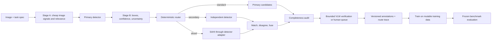

# Specification: adaptive routing for custom object detection

Requirements and acceptance criteria for this project. Status of each item is tracked on the [project board](project_board.md); this document changes only when requirements change.

Source: the original plan (Part B of `git show 208713e:docs/project_board.md`), without the Codex execution prompt. The repository layout below is as built.

## Goal and integration boundary

Add an image-level routing layer to the existing self-hosted Python detector pipeline. It decides how much inference and review each image needs, then emits traceable candidate annotations for the current dataset writer and trainer. It must support arbitrary project-defined classes, including classes absent from public detection taxonomies. Python owns routing decisions; Claude Code or Codex can implement and inspect the code, but neither is a runtime decision maker.

**First repository task:** locate the current image manifest, class registry, primary detector call, prediction format, annotation writer, training entry point and evaluation split. Wrap those interfaces. Preserve current detector and annotation behavior behind a feature flag until the new path passes the acceptance tests. This plan does not assume a particular detector family, labeling format or VLM. *(Greenfield here: see "Integration notes" on the [project board](project_board.md).)*

Each image has three distinct questions:

1. **Relevance:** How likely is at least one configured target class present? Estimate per class and aggregate to image level. Relevance is not image quality.
2. **Difficulty:** How likely is the primary detector to miss or mislocalize a target **if one is present**? Estimate from visual and prediction signals. Record `unknown` when evidence is insufficient.
3. **Annotation completeness:** After candidate fusion, is there evidence of a target instance with no accepted annotation? This is an audit result, not another synonym for difficulty.

Keep raw embedding similarity, calibrated probability, quality signals and difficulty score in separate fields. In particular, `zero primary detections` never implies `easy` or `irrelevant`.

## Processing graph



### Two-stage scoring

**Stage A, before detection:** validate the image; compute resolution, blur/exposure/compression indicators, a domain-distance indicator if a reference distribution exists, and per-class text–image similarity using class-specific positive prompts and confusing negative prompts. The stage outputs raw features plus calibrated relevance probabilities when a calibrator exists. It may flag a likely hard image but must not claim an object-size or occlusion measurement without an object proposal.

**Stage B, after primary detection:** calculate normalized box area, predicted crowding/overlap, confidence or margins when supported, class ambiguity, count, and the contradiction between high relevance and zero boxes. Use Stage A and these features to estimate difficulty. If a secondary detector is run, recompute with class-aware matching and disagreement. Store `difficulty_pre_secondary` and `difficulty_final`; never silently replace the former, because its value explains why the secondary path was selected.

For matched boxes, use an explicitly configured IoU threshold and class mapping. Disagreement includes unmatched candidates from either detector and localization differences among matched boxes; record direction and count, not just a Boolean. A secondary model trained on identical data may have correlated errors, so its disagreement is evidence for review, not ground truth. If no secondary model exists, mark disagreement `unavailable` and allow routing from other signals.

## Contracts and repository layout

Suggested package, adapted to the repository. As built:

```text
src/routing/
  schemas.py       Pydantic v2 records + JSON Schema export
  task_config.py   class registry, prompts, thresholds, budgets, policy knobs, versions
  scoring.py       Stage A and Stage B feature extraction
  adapters.py      detector / relevance / VLM protocols; precomputed + LM Studio adapters
  slicing.py       native SAHI-style tiling and original-coordinate conversion
  matching.py      class-aware matching, deduplication, provenance-preserving fusion
  policy.py        pure deterministic route function
  completeness.py  unmatched proposals and coverage audit
  pipeline.py      bounded orchestration, persistence, resumability, job lock
  evaluation.py    isolation, frozen lock, route/cost report, VLM agreement
  export.py        COCO-style versioned export + loader
  cli.py           vad-route
src/services/
  service_contracts.py  svc-1.0 detector wire models
  remote_adapters.py    remote detector and relevance-scorer clients
  embedder.py           optional open_clip scorer + CUDA-event timer
  grounding_dino/       detector server (own environment)
configs/routing/example.yaml
tests/routing/, tests/services/
```

Define Pydantic v2 models and export their JSON Schemas. Reject unknown class IDs, nonfinite scores, invalid boxes, missing model versions and unsupported coordinate systems. Store a `schema_version` and content/hash IDs on every persisted record. Use canonical `xyxy` **pixel coordinates in the original image**, with `0 <= x1 < x2 <= width` and the analogous y rule. Convert sliced boxes before matching; keep slice origin and model provenance. Keep model confidences as raw model outputs rather than calling them calibrated probabilities.

Minimum contract example (illustrative values, not tuned thresholds):

```json
{
  "schema_version": "1.0",
  "image": {"id": "sha256-or-stable-id", "uri": "images/001.jpg", "width": 1920, "height": 1080, "sha256": "..."},
  "task": {"task_id": "site-safety-v1", "class_ids": ["helmet", "vest"], "prompt_set_version": "p1"},
  "run": {"config_hash": "...", "primary_model": "model@hash", "secondary_model": null, "relevance_calibrator": "cal@hash", "difficulty_calibrator": "cal@hash"},
  "stage_a": {"per_class": {"helmet": {"raw_similarity": 0.42, "relevance_probability": 0.71}, "vest": {"raw_similarity": 0.27, "relevance_probability": 0.19}}, "image_relevance_probability": 0.76, "quality": {"blur": 0.18, "exposure": 0.05}, "warnings": []},
  "primary_candidates": [{"id": "p1", "class_id": "helmet", "box_xyxy": [100, 80, 135, 115], "raw_confidence": 0.61, "source": "primary", "model_version": "model@hash"}],
  "stage_b": {"difficulty_pre_secondary": 0.64, "difficulty_final": 0.64, "bucket": "hard", "features": {"min_box_area_fraction": 0.00059, "crowding": 0.0}, "disagreement": {"status": "unavailable"}},
  "route": {"actions": ["secondary", "sahi", "vlm_verify"], "reason_codes": ["small_candidate", "high_miss_risk"], "policy_version": "route-v1", "budget_used": {"slices": 12, "vlm_calls": 1}},
  "final_candidates": [{"id": "f1", "class_id": "helmet", "box_xyxy": [100, 80, 135, 115], "status": "accepted", "source_ids": ["p1"]}],
  "completeness": {"status": "needs_review", "unmatched_candidate_ids": [], "suspected_missing_classes": ["vest"], "reason_codes": ["high_relevance_zero_boxes_for_class"]},
  "trace": {"elapsed_ms": 420, "gpu_ms": 310, "warnings": []}
}
```

Separate request/config types: `TaskSpec(class_id, display_name, positive_prompts, negative_prompts, aliases)`, `ImageRef`, `Detection`, `ScoreRecord`, `RouteDecision`, `VerificationRequest`, `VerificationResult` and `AnnotationAudit`. `VerificationResult` is constrained to `present | absent | uncertain`, the requested class, cited candidate IDs or image regions, and a reason code; invalid or unparseable VLM output becomes `uncertain`. The VLM cannot directly create a final accepted box. Human approval or a configured detector-supported proposal is required for a new box.

## Deterministic policy, version 1

All numbers below are **configuration placeholders**. Existing raw similarity cutoffs `0.3` and `0.5` from the prior discussion can seed relevance bands only if the current embedding model uses that same scale; they are not difficulty cutoffs or calibrated probabilities. Run the shadow phase before enabling automatic discard.

1. Run Stage A and primary inference on every valid image in the initial release. Invalid/corrupt images go to an explicit error queue.
2. Compute image relevance as the calibrated probability of any target being present, accounting for class correlations during calibration rather than simply summing per-class values. If unavailable, use raw similarity bands and label the result `uncalibrated`.
3. Set `difficulty=unknown` if key signals are missing or the primary detector has zero boxes. Zero boxes with high relevance triggers at least a secondary pass or a bounded spot check.
4. For high-relevance, low-difficulty images with coherent primary detections: accept the standard path, then audit completeness.
5. For medium difficulty or moderate relevance: run the independent secondary detector if configured, match/fuse candidates, and verify only unresolved discrepancies.
6. For high difficulty, a small-object risk, severe crowding, or high relevance with zero boxes: run SAHI if an adapter and remaining slice budget exist; add secondary inference when configured. Run VLM verification for unresolved candidates or suspected missing classes. SAHI tile size, overlap, merge strategy and full-image pass are task configuration, tuned on calibration data.
7. For low relevance: keep the image in a sampled audit pool, including a fixed share of zero-box images and images with poor quality/domain shift. Do not silently discard until the measured false-negative risk of this gate meets the target. A low-relevance image with detector evidence is routed for review, not discarded.
8. Enforce caps on slices, VLM calls, elapsed time and GPU time per image. On cap or model failure, emit `needs_review` with the trace; do not convert an unverified image to a clean negative. No recursive retries. Persist route decisions before expensive calls so restarts are idempotent.

Represent the policy as ordered pure rules over typed scores. Return the action list, priority, reason codes and expected budget. Fixed config, model artifacts, image bytes and random seed must reproduce the route. For randomized low-relevance audits, select by a stable hash of image ID and policy seed, not process order.

**Candidate fusion:** class-aware matching in original coordinates; preserve all source predictions, then choose one canonical box under a documented tie rule. Suppression may remove duplicate display boxes but must not erase disagreement or a candidate requiring audit. VLM output may confirm/reject a candidate or request review; it is not a localization oracle.

**Completeness audit:** compare fused candidates against accepted annotations by class and IoU; collect unmatched candidates, high-relevance classes with no accepted box, and audit-sampled negatives. Status is `complete | needs_review | unresolved` with reason codes and reviewer outcome. Do not claim complete solely because all model boxes were accepted. Record whether a human or a calibrated audit policy established completeness.

## Calibration and frozen evaluation

Create a task-specific, human-checked sample across class, source/domain, image resolution, object size, crowding, positive/negative images and low similarity. Split by video/source/near-duplicate group to avoid leakage. Keep three disjoint sets: **calibration** for fitting probabilities and thresholds; **development** for implementation choices; **frozen evaluation** for final comparison. Version and lock the frozen image IDs and annotations before tuning. Never feed frozen images, or reviewer corrections from them, into model training, prompt selection or threshold fitting.

Calibrate relevance against `any target present`, and difficulty against a clearly defined primary-detector failure event, e.g. at least one missed ground-truth instance at the agreed IoU/class criterion. Report reliability by class/domain; use a global fallback only where samples are sparse. Select thresholds under explicit constraints: maximum allowed missed relevant images at the relevance gate, minimum recall on hard/small objects, maximum false positives per image, and processing budget. Use confidence intervals or a bootstrap by source group; defer automatic rejection when evidence is thin. Record calibrator versions and the exact calibration data hash.

Compare **baseline primary-only**, **always-expensive** and **adaptive** pipelines on the same frozen set. Report mAP50–95, class- and size-stratified recall, missed-instance recovery, false positives/image, annotation precision and completeness, review rate, latency percentiles, GPU seconds/image, VLM calls/image, and route confusion by domain. Include a low-relevance audit estimate of the false-negative rate. Analyze VLM agreement against human labels; never score a VLM self-judgment as ground truth. Evaluate annotations separately from the detector trained on them. For training benefit, train identical detector configurations on versioned baseline versus routed annotation sets, then evaluate both on the frozen set.

Promotion gate: adaptive routing must meet project-set recall and false-negative constraints, show a useful cost/latency reduction versus always-expensive processing, and avoid a material precision regression versus primary-only. Record numeric targets in the repository config before the frozen run; the plan intentionally does not invent task-specific targets.

## Acceptance tests

| Test | Required result |
|---|---|
| Arbitrary class registry | A class absent from public datasets flows through prompts, adapters, route, VLM contract and annotation export without hard-coded mappings. |
| Independence | Low relevance/high difficulty and high relevance/low difficulty keep distinct scores and take the configured routes. |
| Zero detections | High relevance plus zero boxes never becomes `easy` or an accepted negative; missing secondary/VLM capacity creates review. |
| Stable routing | Same image, artifact hashes, config and seed give identical actions, reasons and audit sampling across process restarts. |
| Disagreement | Matched, unmatched, duplicate and cross-class boxes give correct directional disagreement and keep provenance. |
| SAHI coordinates | Tile-edge and overlap detections map to original pixels once, deduplicate correctly and stay in bounds. |
| VLM failures | Malformed, contradictory, timed-out or unavailable responses become `uncertain`; retry/call caps hold. |
| Completeness | A missing ground-truth-like proposal, a high-relevance class with no box, and an audited zero-box image create explicit unresolved/review states. |
| Budget and recovery | Slice/time/GPU limits stop escalation; a repeated job resumes without duplicate calls or annotations. |
| Data isolation | Calibration and frozen-eval group IDs don't overlap training; changing thresholds never rewrites frozen annotations. |
| End-to-end | On a tiny checked fixture, exported annotations load in the existing training pipeline and the route trace explains each decision. |

## Reference notes

SAHI's official [documentation](https://obss.github.io/sahi/) describes sliced inference and detector integration; choose its installed API and merge settings only after inspecting the repository environment. Pydantic's [model documentation](https://docs.pydantic.dev/latest/concepts/models/) supports typed validation; export schemas from the pinned version used by the repository. These references inform adapter design, not the task-specific thresholds or evaluation targets.
