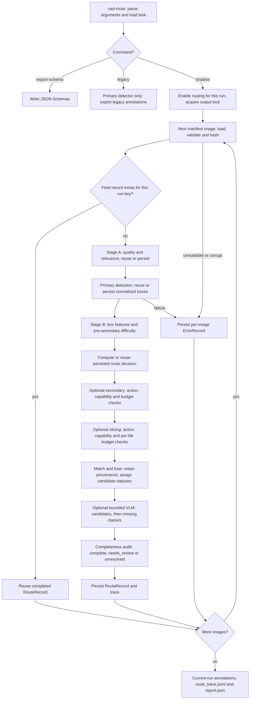
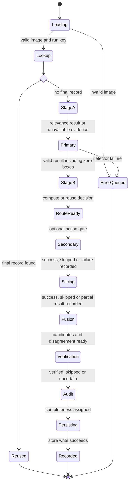
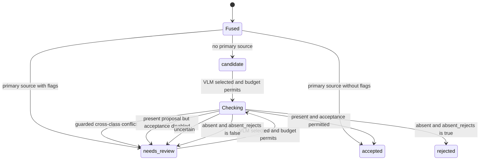
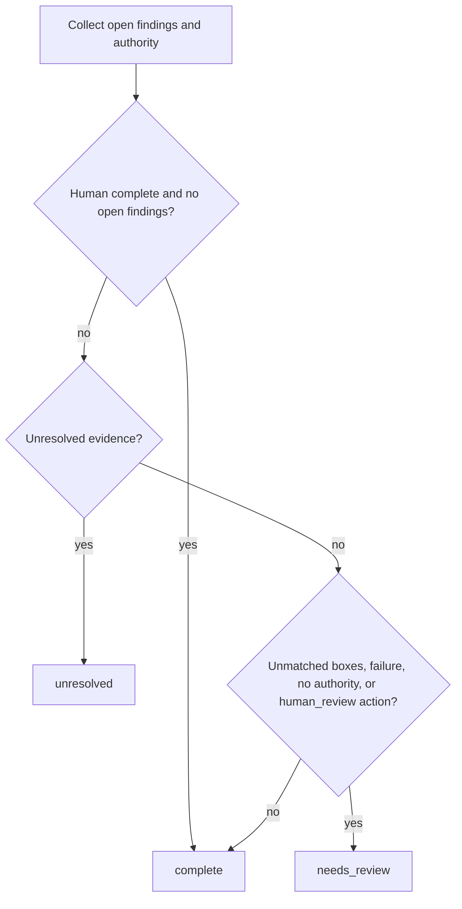
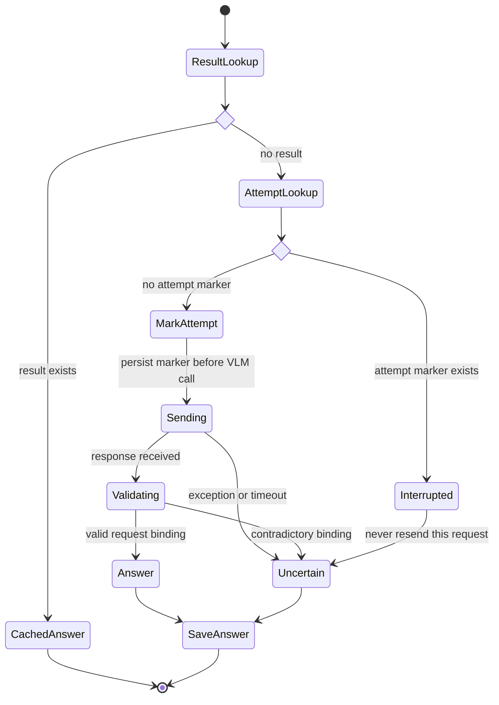

# Specification: adaptive routing for custom object detection

Requirements, acceptance criteria and the implemented execution flow for this project. Status of each item is tracked on the [project board](project_board.md). Keep the execution diagrams aligned with runtime behavior; the later calibration and rollout requirements describe the intended release gates.

Source: the original plan (Part B of `git show 208713e:docs/project_board.md`), without the Codex execution prompt. The repository layout below is as built.

## Goal and integration boundary

Add an image-level routing layer to the existing self-hosted Python detector pipeline. It decides how much inference and review each image needs, then emits traceable candidate annotations for the current dataset writer and trainer. It must support arbitrary project-defined classes, including classes absent from public detection taxonomies. Python owns routing decisions; Claude Code or Codex can implement and inspect the code, but neither is a runtime decision maker.

**First repository task:** locate the current image manifest, class registry, primary detector call, prediction format, annotation writer, training entry point and evaluation split. Wrap those interfaces. Preserve current detector and annotation behavior behind a feature flag until the new path passes the acceptance tests. This plan does not assume a particular detector family, labeling format or VLM. *(Greenfield here: see "Integration notes" on the [project board](project_board.md).)*

Each image has three distinct questions:

1. **Relevance:** How likely is at least one configured target class present? Estimate per class and aggregate to image level. Relevance is not image quality.
2. **Difficulty:** How likely is the primary detector to miss or mislocalize a target **if one is present**? Estimate from visual and prediction signals. Record `unknown` when evidence is insufficient.
3. **Annotation completeness:** After candidate fusion, is there evidence of a target instance with no accepted annotation? This is an audit result, not another synonym for difficulty.

Keep raw embedding similarity, calibrated probability, quality signals and difficulty score in separate fields. In particular, `zero primary detections` never implies `easy` or `irrelevant`.

## Processing graph

The following describes the implementation at `f976203`. The runtime is ordinary Python orchestration, not a state-machine framework. State names in the diagrams explain control flow; only the schemas, cached step payloads, records and errors described below are persisted. Source links are relative to this document.



`standard`, `secondary`, `sahi`, `vlm_verify`, `human_review` and `audit_sample` are **combinable actions**, not mutually exclusive processing states. The pipeline checks membership in the action list and executes secondary before slicing, regardless of the list's order. `human_review` records review requirements; it does not pause the process or launch a review UI. Training and frozen benchmarking remain downstream workflows, not steps performed by `vad-route shadow`.

### Command and batch boundaries

[cli.main](../src/routing/cli.py) constructs providers and loads the manifest before entering the shadow output lock. Invalid command/configuration, manifest-loading errors and setup failures stop the command; they are outside the per-image error queue. `StoreLockedError` returns exit code 2. Shadow mode explicitly sets `routing_enabled=True` for that invocation; the default configuration remains disabled. The legacy branch calls `legacy_predict` directly and does not use routed per-image recovery.

[RoutingPipeline.run](../src/routing/pipeline.py) processes manifest entries sequentially. Each `process` returns either a `RouteRecord` or `ErrorRecord`, so an unreadable image or primary inference failure does not stop later valid entries. This assumes error persistence itself succeeds. Unexpected uncaught errors during scoring, fusion, audit or record construction also become per-image errors, tagged with the last `_step`.

### Per-image execution state machine



| Stage / source | What happens | State retained for explanation or recovery |
|---|---|---|
| Loading / `image_inputs.load_image` | Read bytes, verify/decode, convert to RGB and build an `ImageRef` with byte digest. | An invalid image produces an error; no detection is attempted. |
| Lookup / `process`, `record_key` | Combine image identity with `RunInfo`, including configuration/model identities and available artifact digests. | A final-record hit returns immediately after image validation. |
| Stage A / `scoring.stage_a` | Quality signals plus optional per-class relevance; a scorer exception yields unavailable relevance and a warning. | `stage_a` cache includes failures represented as unavailable evidence; resume reuses it. |
| Primary / `_cached_detect` | Run or replay primary predictions and map valid boxes to original-image coordinates. An explicit empty prediction row is valid; an omitted replay row raises. | `primary` cache stores detections, warnings and measured GPU time. |
| Stage B / `box_features`, `estimate_difficulty` | Calculate features and `difficulty_pre_secondary`; zero boxes imply unknown difficulty. | Derived again from cached inputs until the final record is saved. |
| Route / `policy.route` | Apply ordered rules and available capabilities; persist before optional escalation. | `route` contains actions, reasons, priority and expected budget. |
| Secondary and slicing | Check the action, adapter and budget; normalize/fuse tile results. Optional failures accumulate review reasons. | `secondary` and `sahi` caches; slicing retains raw predictions, merged predictions, count and stop reason. |
| Fusion / `_candidates` | Match primary/secondary detections, derive disagreement, fuse all detector sources and assign initial statuses. | Preserve both difficulty snapshots. `difficulty_final` is recomputed only when secondary ran; it does not trigger a second routing pass. |
| Verification / `_verify` | Check reviewable candidates in stable order, then high-relevance classes without an accepted box, using one shared call cap. | Per-request result/attempt markers; VLM outcomes cannot create geometry. |
| Audit and persistence / `completeness.audit`, `RouteStore` | Evaluate coverage and open evidence; save the final trace and record. | Final completeness and all source/candidate/verification records. |

Exceptions not drawn individually in the state diagram follow `process`'s outer error handler. A handled relevance, secondary or slicing failure stays on the normal path with unknown evidence or review reasons. A VLM failure becomes `uncertain` when a request was attempted. Skipping a request on a budget leaves the candidate unchanged and adds a failure reason.

### Route selection and budget guards

[policy.route](../src/routing/policy.py) applies the following main branches, then adds calibrated-missing-class and sampled-quality review requirements. Availability changes the selected actions.

| Evidence, in branch order | Route behavior |
|---|---|
| Low relevance, zero primary boxes | Standard path plus a deterministic sampled audit; no automatic discard. |
| Low relevance with boxes | Standard plus VLM verification, or human review when VLM is unavailable. |
| Non-low relevance, zero boxes | High relevance escalates; moderate relevance takes the moderate path. Unknown relevance uses the configured medium/high interpretation. |
| Non-low relevance with boxes and hard/small/crowded evidence | Escalate: plan slicing if available and within slice count, add secondary and VLM when configured; otherwise record unavailable capabilities/review. |
| Remaining medium/unknown difficulty or moderate relevance | Secondary if available, plus VLM when available. Without secondary, use the configured VLM-then-human or human fallback. |
| Remaining high relevance and low difficulty | Standard path. |

Unknown relevance is never treated as low. An omitted calibrated class adds `human_review` and never falls back to raw probability thresholds. Poor-quality sampling can add review to any branch.

Budgets are cooperative guards: Stage A and primary still run for every valid uncached image. Elapsed time is checked before optional work and before each slice; an in-flight call can exceed that budget. GPU limits use adapter-measured time only, and become unenforceable when the aggregate is unknown (`None`). Slicing returns partial results with a stop reason; it does not silently claim a complete pass. VLM call counts include cached answers reached through `ask`, preserving the logical per-image cap on resume. Provider timeouts are separate from the pipeline elapsed budget; the WeMM client currently retries a transport failure once.

### Candidate status state machine

[RoutingPipeline._candidates](../src/routing/pipeline.py) initially accepts an unflagged primary-backed fused box. A non-primary proposal begins as `candidate`; flagged primary-backed boxes begin as `needs_review`. Examples of flags are cross-class conflict, mislocalization, primary-only disagreement, low relevance and missing planned confirmation.



`Checking` and `Fused` are explanatory states, not schema values. If verification is skipped, `candidate`/`needs_review` remains unchanged. `_candidate_status_after_verification` checks the cross-class guard **before** interpreting the verdict. A `present` verdict can accept an existing detector proposal only when `accept_confirmed_detector_proposals` permits it; the VLM never authors or moves boxes. Accepted and rejected candidates are not re-verified during this pass.

### Image completeness is a separate decision

[completeness.audit](../src/routing/completeness.py) evaluates the entire image after candidate verification. Its statuses do not replace box statuses:

1. Collect unmatched `candidate`/`needs_review` boxes, failures and suspected missing classes. A high-relevance class without an accepted box is unresolved when its check is missing, uncertain or reports an unannotated instance. An uncertain candidate verification also creates unresolved evidence.
2. A calibrated class with missing probability and no accepted box remains unresolved. A VLM answer cannot resolve that missing relevance evidence.
3. Establish authority from `human_outcome`, otherwise a configured calibrated audit policy, otherwise `none`.
4. Apply the precedence below. A human `complete` cannot clear unmatched candidates, unresolved evidence or failed escalation without adjudicating those findings.



The current pipeline does not pass human outcomes or reference annotations into `audit`; those parameters are helper-level capabilities. Reviewer ingestion and re-auditing are future work. With no human outcome and no calibrated audit policy, even an image whose boxes are all accepted remains `needs_review` unless unresolved evidence requires the stronger `unresolved` status.

### Restart and VLM request recovery

[RouteStore](../src/routing/store.py) persists independent step payloads; it does not save a single execution-state enum. Restart begins at image loading, returns a saved final record if present, otherwise traverses the same stages and reuses the available step results.



This request machine runs only when `_verify` reaches the request within its budget. Cache keys are `vlm:<request-id>` and `vlm_attempt:<request-id>`. Request binding includes class, candidate IDs and region as well as request ID. Malformed provider responses are normalized to uncertain by the adapter. If the process dies after the marker but before the answer is persisted, resume records `vlm_interrupted` as uncertain instead of repeating inference—even if the original call was never sent. This is the deliberate at-most-once tradeoff.

Detector steps have no equivalent attempt marker. A crash after inference but before its cache write can repeat that detector call. Sliced inference is cached after the sliced operation returns, not after every tile, so interruption can repeat tiles. A saved final record is reused; its historical timings/warnings are not recomputed. Changing configuration or recorded artifact identity creates a different run key; changing an unverified remote model behind the same identity does not automatically invalidate SQLite results.

### Output and downstream boundary

Shadow mode writes only records returned for the current invocation:

- `annotations.json`: all valid routed images with completeness metadata, and only `accepted` candidate boxes, converted from xyxy to COCO-style xywh.
- `route_trace.jsonl`: complete `RouteRecord` values, including proposals, provenance, verifications and completeness.
- `report.json`: route/cost summaries, relevance-scorer failure counts and the current invocation's per-image errors.

An image may export accepted boxes while still being `needs_review` or `unresolved`; accepted geometry does not prove full coverage. The current export does **not** enforce a complete-images-only training gate. Frozen-split enforcement, human adjudication, actual trainer integration and promotion remain requirements described below and tracked on the board.

### Two-stage scoring

**Stage A, before detection:** validate the image; compute resolution, blur/exposure/compression indicators, a domain-distance indicator if a reference distribution exists, and per-class text–image similarity using class-specific positive prompts and confusing negative prompts. The stage outputs raw features plus calibrated relevance probabilities when a calibrator exists. It may flag a likely hard image but must not claim an object-size or occlusion measurement without an object proposal.

**Stage B, after primary detection:** calculate normalized box area, predicted crowding/overlap, confidence or margins when supported, class ambiguity, count, and the contradiction between high relevance and zero boxes. Use Stage A and these features to estimate difficulty. If a secondary detector is run, recompute with class-aware matching and disagreement. Store `difficulty_pre_secondary` and `difficulty_final`; never silently replace the former, because its value explains why the secondary path was selected.

For matched boxes, use an explicitly configured IoU threshold and class mapping. Disagreement includes unmatched candidates from either detector and localization differences among matched boxes; record direction and count, not just a Boolean. A secondary model trained on identical data may have correlated errors, so its disagreement is evidence for review, not ground truth. If no secondary model exists, mark disagreement `unavailable` and allow routing from other signals.

## Contracts and repository layout

Suggested package, adapted to the repository. As built:

```text
src/routing/
  schemas.py       Pydantic v2 records + JSON Schema export
  task_config.py   class registry, prompts, thresholds, budgets, policy knobs, versions
  scoring.py       Stage A and Stage B feature extraction
  interfaces.py    detector / relevance / VLM protocols and result types
  detection_mapping.py, verification_results.py  box mapping; VLM result parsing
  slicing.py       native SAHI-style tiling and original-coordinate conversion
  matching.py      class-aware matching, deduplication, provenance-preserving fusion
  policy.py        pure deterministic route function
  completeness.py  unmatched proposals and coverage audit
  pipeline.py      bounded orchestration and resumability
  store.py, image_inputs.py  persistence + job lock; manifest/image loading
  evaluation.py    isolation, frozen lock, route/cost report, VLM agreement
  export.py        COCO-style versioned export + loader
  cli.py           vad-route
src/services/
  contracts.py          svc-1.0 detector wire models
  http_detector.py, wemm_mcp.py, lmstudio.py  detector, relevance and VLM clients
  replay.py, open_clip.py, runtime.py  replay adapters; optional local scorer; shared helpers
  grounding_dino/       detector server (own environment)
configs/routing/example.yaml
tests/routing/, tests/services/
```

Define Pydantic v2 models and export their JSON Schemas. Reject unknown class IDs, nonfinite scores, invalid boxes, missing model versions and unsupported coordinate systems. Store a `schema_version` and content/hash IDs on every persisted record. Use canonical `xyxy` **pixel coordinates in the original image**, with `0 <= x1 < x2 <= width` and the analogous y rule. Convert sliced boxes before matching; keep slice origin and model provenance. Keep model confidences as raw model outputs rather than calling them calibrated probabilities.

Minimum contract example (illustrative values, not tuned thresholds):

```json
{
  "schema_version": "1.0",
  "image": {"id": "sha256-or-stable-id", "uri": "images/001.jpg", "width": 1920, "height": 1080, "sha256": "..."},
  "task": {"task_id": "site-safety-v1", "class_ids": ["helmet", "vest"], "prompt_set_version": "p1"},
  "run": {"config_hash": "...", "primary_model": "model@hash", "secondary_model": null, "relevance_calibrator": "cal@hash", "difficulty_calibrator": "cal@hash"},
  "stage_a": {"per_class": {"helmet": {"raw_similarity": 0.42, "relevance_probability": 0.71}, "vest": {"raw_similarity": 0.27, "relevance_probability": 0.19}}, "image_relevance_probability": 0.76, "quality": {"blur": 0.18, "exposure": 0.05}, "warnings": []},
  "primary_candidates": [{"id": "p1", "class_id": "helmet", "box_xyxy": [100, 80, 135, 115], "raw_confidence": 0.61, "source": "primary", "model_version": "model@hash"}],
  "stage_b": {"difficulty_pre_secondary": 0.64, "difficulty_final": 0.64, "bucket": "hard", "features": {"min_box_area_fraction": 0.00059, "crowding": 0.0}, "disagreement": {"status": "unavailable"}},
  "route": {"actions": ["secondary", "sahi", "vlm_verify"], "reason_codes": ["small_candidate", "high_miss_risk"], "policy_version": "route-v1", "budget_used": {"slices": 12, "vlm_calls": 1}},
  "final_candidates": [{"id": "f1", "class_id": "helmet", "box_xyxy": [100, 80, 135, 115], "status": "accepted", "source_ids": ["p1"]}],
  "completeness": {"status": "needs_review", "unmatched_candidate_ids": [], "suspected_missing_classes": ["vest"], "reason_codes": ["high_relevance_zero_boxes_for_class"]},
  "trace": {"elapsed_ms": 420, "gpu_ms": 310, "warnings": []}
}
```

Separate request/config types: `TaskSpec(class_id, display_name, positive_prompts, negative_prompts, aliases)`, `ImageRef`, `Detection`, `ScoreRecord`, `RouteDecision`, `VerificationRequest`, `VerificationResult` and `AnnotationAudit`. `VerificationResult` is constrained to `present | absent | uncertain`, the requested class, cited candidate IDs or image regions, and a reason code; invalid or unparseable VLM output becomes `uncertain`. The VLM cannot directly create a final accepted box. Human approval or a configured detector-supported proposal is required for a new box.

## Deterministic policy, version 1

All numbers below are **configuration placeholders**. Existing raw similarity cutoffs `0.3` and `0.5` from the prior discussion can seed relevance bands only if the current embedding model uses that same scale; they are not difficulty cutoffs or calibrated probabilities. Run the shadow phase before enabling automatic discard.

1. Run Stage A and primary inference on every valid image in the initial release. Invalid/corrupt images go to an explicit error queue.
2. Compute image relevance as the calibrated probability of any target being present, accounting for class correlations during calibration rather than simply summing per-class values. If unavailable, use raw similarity bands and label the result `uncalibrated`.
3. Set `difficulty=unknown` if key signals are missing or the primary detector has zero boxes. Zero boxes with high relevance triggers at least a secondary pass or a bounded spot check.
4. For high-relevance, low-difficulty images with coherent primary detections: accept the standard path, then audit completeness.
5. For medium difficulty or moderate relevance: run the independent secondary detector if configured, match/fuse candidates, and verify only unresolved discrepancies.
6. For high difficulty, a small-object risk, severe crowding, or high relevance with zero boxes: run SAHI if an adapter and remaining slice budget exist; add secondary inference when configured. Run VLM verification for unresolved candidates or suspected missing classes. SAHI tile size, overlap, merge strategy and full-image pass are task configuration, tuned on calibration data.
7. For low relevance: keep the image in a sampled audit pool, including a fixed share of zero-box images and images with poor quality/domain shift. Do not silently discard until the measured false-negative risk of this gate meets the target. A low-relevance image with detector evidence is routed for review, not discarded.
8. Enforce caps on slices, VLM calls, elapsed time and GPU time per image. On cap or model failure, emit `needs_review` with the trace; do not convert an unverified image to a clean negative. No recursive retries. Persist route decisions before expensive calls so restarts are idempotent.

Represent the policy as ordered pure rules over typed scores. Return the action list, priority, reason codes and expected budget. Fixed config, model artifacts, image bytes and random seed must reproduce the route. For randomized low-relevance audits, select by a stable hash of image ID and policy seed, not process order.

**Candidate fusion:** class-aware matching in original coordinates; preserve all source predictions, then choose one canonical box under a documented tie rule. Suppression may remove duplicate display boxes but must not erase disagreement or a candidate requiring audit. VLM output may confirm/reject a candidate or request review; it is not a localization oracle.

**Completeness audit:** compare fused candidates against accepted annotations by class and IoU; collect unmatched candidates, high-relevance classes with no accepted box, and audit-sampled negatives. Status is `complete | needs_review | unresolved` with reason codes and reviewer outcome. Do not claim complete solely because all model boxes were accepted. Record whether a human or a calibrated audit policy established completeness.

## Calibration and frozen evaluation

Create a task-specific, human-checked sample across class, source/domain, image resolution, object size, crowding, positive/negative images and low similarity. Split by video/source/near-duplicate group to avoid leakage. Keep three disjoint sets: **calibration** for fitting probabilities and thresholds; **development** for implementation choices; **frozen evaluation** for final comparison. Version and lock the frozen image IDs and annotations before tuning. Never feed frozen images, or reviewer corrections from them, into model training, prompt selection or threshold fitting.

Calibrate relevance against `any target present`, and difficulty against a clearly defined primary-detector failure event, e.g. at least one missed ground-truth instance at the agreed IoU/class criterion. Report reliability by class/domain; use a global fallback only where samples are sparse. Select thresholds under explicit constraints: maximum allowed missed relevant images at the relevance gate, minimum recall on hard/small objects, maximum false positives per image, and processing budget. Use confidence intervals or a bootstrap by source group; defer automatic rejection when evidence is thin. Record calibrator versions and the exact calibration data hash.

Compare **baseline primary-only**, **always-expensive** and **adaptive** pipelines on the same frozen set. Report mAP50–95, class- and size-stratified recall, missed-instance recovery, false positives/image, annotation precision and completeness, review rate, latency percentiles, GPU seconds/image, VLM calls/image, and route confusion by domain. Include a low-relevance audit estimate of the false-negative rate. Analyze VLM agreement against human labels; never score a VLM self-judgment as ground truth. Evaluate annotations separately from the detector trained on them. For training benefit, train identical detector configurations on versioned baseline versus routed annotation sets, then evaluate both on the frozen set.

Promotion gate: adaptive routing must meet project-set recall and false-negative constraints, show a useful cost/latency reduction versus always-expensive processing, and avoid a material precision regression versus primary-only. Record numeric targets in the repository config before the frozen run; the plan intentionally does not invent task-specific targets.

## Acceptance tests

| Test | Required result |
|---|---|
| Arbitrary class registry | A class absent from public datasets flows through prompts, adapters, route, VLM contract and annotation export without hard-coded mappings. |
| Independence | Low relevance/high difficulty and high relevance/low difficulty keep distinct scores and take the configured routes. |
| Zero detections | High relevance plus zero boxes never becomes `easy` or an accepted negative; missing secondary/VLM capacity creates review. |
| Stable routing | Same image, artifact hashes, config and seed give identical actions, reasons and audit sampling across process restarts. |
| Disagreement | Matched, unmatched, duplicate and cross-class boxes give correct directional disagreement and keep provenance. |
| SAHI coordinates | Tile-edge and overlap detections map to original pixels once, deduplicate correctly and stay in bounds. |
| VLM failures | Malformed, contradictory, timed-out or unavailable responses become `uncertain`; retry/call caps hold. |
| Completeness | A missing ground-truth-like proposal, a high-relevance class with no box, and an audited zero-box image create explicit unresolved/review states. |
| Budget and recovery | Slice/time/GPU limits stop escalation; a repeated job resumes without duplicate calls or annotations. |
| Data isolation | Calibration and frozen-eval group IDs don't overlap training; changing thresholds never rewrites frozen annotations. |
| End-to-end | On a tiny checked fixture, exported annotations load in the existing training pipeline and the route trace explains each decision. |

## Research references and implementation mapping

**Evidence boundary (2026-11-09):** the architecture combines established techniques with project-specific heuristics. The cited work supports individual components or related ideas; none evaluates this repository's complete router, its weights, thresholds or completeness guarantee. Source mappings below reflect the inspected working tree, where service flattening and OpenCLIP removal are in progress. Update links after moves; the proposed flat package layout is not yet the runtime layout. OpenCLIP is not a required dependency for these references.

### Reference documents

| ID | Primary reference | Supported scope and limits |
|---|---|---|
| R1 | S. Pertuz, D. Puig and M. A. Garcia, **Analysis of focus measure operators for shape-from-focus**, *Pattern Recognition*, 46(5), 1415–1432, 2013. [Publication and DOI](https://researchportal.tuni.fi/en/publications/analysis-of-focus-measure-operators-for-shape-from-focus/); [author's Focus Measure implementation](https://www.mathworks.com/matlabcentral/fileexchange/27314-focus-measure). | Focus measures provide sharpness cues. This is not a validation of our whole-image quality assessment, exposure cutoffs or inverse blur normalization. |
| R2 | Tencent, **WeMM-Embedding-4B model card**, technical documentation. [Model card, inference examples and linked technical report](https://huggingface.co/tencent/WeMM-Embedding-4B). | Documents multimodal embeddings and model usage. Vendor documentation supports the selected backend, not our prompt aggregation, thresholds or probability interpretation. |
| R3 | S. Liu et al., **Grounding DINO: Marrying DINO with Grounded Pre-Training for Open-Set Object Detection**, 2023 preprint / ECCV 2024. [Paper](https://arxiv.org/abs/2303.05499); [official implementation](https://github.com/IDEA-Research/GroundingDINO). | Supports language-conditioned detection. Our per-class passes, thresholds, service wrapper and target-domain performance require separate evaluation. The repository uses a Transformers implementation, not the paper's training pipeline or NVIDIA TAO. |
| R4 | F. C. Akyon, S. O. Altinuc and A. Temizel, **Slicing Aided Hyper Inference and Fine-tuning for Small Object Detection**, ICIP 2022. [Paper](https://arxiv.org/abs/2202.06934); [official SAHI implementation](https://github.com/obss/sahi). | Supports sliced inference for small objects. Published gains on other datasets are not predicted gains here; native merging and conditional invocation are our implementation choices. |
| R5 | Y. Wang et al., **ALWOD: Active Learning for Weakly-Supervised Object Detection**, ICCV 2023. [Paper](https://arxiv.org/abs/2309.07914). | Uses disagreement/uncertainty to select annotation work. This is related evidence for review signals; we do not implement its student–teacher training or acquisition algorithm. |
| R6 | C. Guo, G. Pleiss, Y. Sun and K. Q. Weinberger, **On Calibration of Modern Neural Networks**, ICML 2017. [Paper](https://proceedings.mlr.press/v70/guo17a.html). | Establishes the need to assess probability calibration; studies classification and post-processing, including temperature scaling. It does not justify applying temperature scaling directly to our cosine scores or heuristic difficulty. |
| R7 | F. Küppers, J. Kronenberger, A. Shantia and A. Haselhoff, **Multivariate Confidence Calibration for Object Detection**, CVPR Workshops 2020. [Paper](https://arxiv.org/abs/2004.13546). | Extends calibration to detector outputs using box information, including position/scale. Detector correctness calibration is a different target from image relevance or image-level miss risk. |
| R8 | Y. Li et al., **Evaluating Object Hallucination in Large Vision-Language Models**, EMNLP 2023. [Paper and linked POPE code/data](https://arxiv.org/abs/2305.10355). | Motivates object-presence testing and checking hallucination against labels. Our verifier is not an implementation of POPE, and this paper does not establish our crop-verification accuracy. |
| R9 | D. Madras, T. Pitassi and R. Zemel, **Predict Responsibly: Improving Fairness and Accuracy by Learning to Defer**, NeurIPS 2018. [Paper](https://arxiv.org/abs/1711.06664). | Related work for passing decisions to another decision-maker. Our deterministic human-review fallback is not a learned deferral policy, and no accuracy/fairness improvement is established here. |

### Usage in this code base

| Area / references | Current code and behavior | What is not implemented or established |
|---|---|---|
| Quality / R1 | [scoring.quality_signals](../src/routing/scoring.py) computes grayscale Laplacian variance, `blur = 1 / (1 + variance / 100)`, extreme-pixel fraction at ≤5 or ≥250, and shortest-side resolution. [policy.route](../src/routing/policy.py) uses quality for sampled auditing; blur also enters difficulty. | These are diagnostic proxies. Textureless scenes can look blurry; legitimate black/white content can look poorly exposed. No learned quality estimator, compression score, domain-distance population or measured relation to detector failure exists. |
| Relevance / R2 | [WeMMMCPRelevanceScorer.score](../src/services_embedding/client.py) sends an image data URI and positive prompts; takes maximum cosine per class. [stage_a](../src/routing/scoring.py) takes the maximum class score for raw image bands. Missing/error evidence cannot silently become low relevance. | Negative prompts are not used by this scorer; image–image reference matching is planned. Neither prompt pooling nor raw bands are validated on the target distribution. No fitted relevance calibrator is shipped. |
| Detection / R3 | [Grounding DINO server](../src/service_detector_gdino/server.py) loads a pinned model, checks the weights digest and runs once per requested class. [RemoteDetector](../src/service_detector_gdino/client.py) checks response identity. | Synthetic checks establish transport/behavior only. Real class confusion, false positives, prompt robustness and small-object recall need human-labelled evaluation. No independent secondary backend is supplied by this implementation. |
| Small-object recovery / R4 | [slicing.run_sliced](../src/routing/slicing.py) tiles, checks budgets, maps coordinates and merges by IoS while retaining raw parents. Acceptance tests cover offsets, overlap, recovery and caps. | This is a native SAHI-style implementation; it does not import the SAHI library. Paper-level parity, slicing fine-tuning and target-domain accuracy/cost gains have not been demonstrated. |
| Difficulty and disagreement / R5, R7 | [box_features / estimate_difficulty](../src/routing/scoring.py), [matching.disagreement](../src/routing/matching.py) and [pipeline](../src/routing/pipeline.py) combine small boxes, overlap, minimum confidence, blur, class ambiguity and optional secondary disagreement. Zero boxes/confidence absence produce unknown difficulty. | The weighted score is heuristic and always labelled uncalibrated when numeric. No fitted difficulty model or demonstrated ranking of actual missed/mislocalized instances exists. ALWOD is related work rather than the implemented algorithm. |
| Calibration / R6, R7 | [RelevanceCalibrator protocol](../src/routing/interfaces.py), [Stage A guards](../src/routing/scoring.py), configuration thresholds and schema range checks provide a calibration boundary. Tests exercise incomplete/inconsistent outputs. | Interface/guard tests are not calibration experiments. Relevance fitting, coherent aggregate probabilities, reliability diagrams, Brier/ECE metrics and box-sensitive detector calibration are absent. Difficulty has no corresponding fitted calibrator path. |
| Verification / R8 | [VLM client](../src/service_detector_vlm/openai_service_call.py), [answer parser](../src/routing/verification_results.py) and [_verify](../src/routing/pipeline.py) constrain answers and bind them to requests. [vlm_agreement](../src/routing/evaluation.py) reports human agreement, decision coverage and present/absent precision with Wilson bounds. | Agreement tooling has no target-domain human label study attached. It does not measure localization or discover every missing instance. POPE-style negative sampling and prompt/crop sensitivity studies remain to be run. |
| Human review / R9 | [policy](../src/routing/policy.py) and [completeness.audit](../src/routing/completeness.py) retain uncertain/open findings; only accepted geometry is exported. Audit helper accepts human outcomes/reference boxes. | The pipeline/CLI does not ingest per-finding adjudication or human outcomes. No reviewer workload/accuracy study or learned deferral policy is implemented. A review flag is not a completed review. |
| Whole-system validation / all references | [evaluation](../src/routing/evaluation.py) provides split/frozen-lock utilities, route/cost reporting and VLM agreement. [tests](../tests/routing/test_acceptance.py) establish selected behavioral invariants. | No end-to-end research validation: detection metrics, enforced split-aware runs, real-image ablations, numeric promotion results and training-benefit comparison remain missing. An export can contain accepted boxes from incomplete images; training must handle that explicitly. |

### Evidence required before claiming improvement

Use a human-checked dataset, separated by source/near-duplicate group. If the trial starts with roughly 70% tuning and 30% frozen evaluation, further separate the tuning portion into calibration and development groups; the frozen portion must not choose prompts, weights or thresholds. Record image-transfer permission before calling external services on collected images.

Define three different targets: **relevance** = any configured target instance present; **difficulty** = a defined primary miss/localization failure conditional on a target being present; **candidate correctness** = correct class and localization under a fixed one-to-one matching criterion. Negatives additionally measure false positives. Never substitute detector confidence or VLM self-agreement for those labels.

On the same frozen set compare primary-only, primary+slicing, primary+VLM, always-expensive and adaptive runs. Keep model/prompt identities and thresholds fixed; report detection precision/recall, mAP, small-object recovery, review rate, errors/timeouts, latency and GPU/call cost with source-group uncertainty estimates. Report candidate acceptance separately from annotation completeness and any downstream training result. This is a proposed evaluation protocol, not an assertion that these experiments have been performed. Detailed action cards are in [reviewer_suggestion.md](reviewer_suggestion.md).

Pydantic's [model documentation](https://docs.pydantic.dev/latest/concepts/models/) is an implementation reference for typed validation, not research evidence of detection or routing accuracy.
